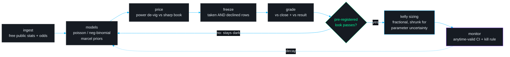

<div align="center">
  
</div>

<p align="center">
  <a href="mailto:FoxWillC@hotmail.com"></a>
  <a href="https://www.linkedin.com/in/fox-camann"></a>
  <a href="https://project-szpu4.vercel.app"></a>
</p>

<h3 align="center">I build systems that can prove themselves wrong.</h3>

<br>

## `fox@edge:~$ whoami`

**Fox Camann.** Business Analytics at the University of Denver (Daniels, 4+1 MS). I do quantitative research on sports betting and prediction markets, build automation for a construction firm, and founded SF Strategies.

I price player props across four leagues, grade every forecast against the de-vigged closing price *and* the result, and treat my own numbers as suspects until a pre-registered test clears them.

```diff
+ every forecast graded twice: vs the de-vigged close, and vs what happened
+ every forward test pre-registered: one look, sample bar and kill rule written first
+ the rows the system declined are kept, so the filter itself can be graded
+ a guard that cannot fail on bad input is not a guard
- backtests tuned until they worked
```

## `fox@edge:~$ htop -u fox`



| process | state | what it runs |
|:--|:--|:--|
| **research-system** | running | Daily pipeline pricing NHL, NBA, MLB and WNBA player props from free public data. 1,000+ Python modules, ~1,000 test files, 100+ health checks. Private. |
| **prereg** | 127 registered | Exploratory study, then a frozen spec: one forward look, fixed sample bar, held-out window, kill rule. Most come back null and stay on file. |
| **[stateedge](https://project-szpu4.vercel.app)** | live | SF Strategies. Tracks US sportsbook promotions by state and computes the fee-aware hedge on a prediction-market exchange. Next.js, Supabase, Stripe. |
| **client-automations** | running | Subcontractor reminders at T-72h and T-24h, meeting notes routed to the attendees detected. DigitalOcean. |

## `fox@edge:~$ cat pipeline.mmd`



```python
# config.py
EDGE = {
    "pricing":    ["poisson", "negative-binomial"],  # count models for goals, shots, points
    "priors":     "marcel, 5/4/3 seasons + regression", # last season is not the player
    "devig":      "power method",                     # beat proportional on held-out data
    "ruler":      "de-vigged closing price",
    "inference":  {"look": "date-clustered bootstrap", # games on one night are not independent
                   "decide": "anytime-valid CI"},     # I peek daily; fixed-n p-values lie
    "staking":    "fractional kelly, shrunk",         # the edge itself is an estimate
}
```

<details>
<summary><code>cat sizing/kelly.py</code></summary>
<br>

```python
def kelly_stake(p_model: float, odds_dec: float, bankroll: float,
                fraction: float = 0.25, cap: float = 0.02) -> float:
    """Quarter-Kelly with a hard exposure cap."""
    b = odds_dec - 1.0                      # net payout per unit staked
    edge = p_model * odds_dec - 1.0         # expected value per unit
    if edge <= 0:
        return 0.0
    f_star = edge / b                       # full kelly fraction
    f = min(fraction * f_star, cap)
    return round(bankroll * f, 2)

# >>> kelly_stake(p_model=0.52, odds_dec=2.06, bankroll=10_000)
# 167.92
```

</details>

## `fox@edge:~$ cat research/silent-failure.md`

A system that grades itself with data it produced can fail in ways its own output cannot show. Every dashboard stays green. Some of what I found on my own book, all reproduced in **[silent-failure-detectors](https://github.com/ThatOneSharpDude/silent-failure-detectors)**:

| failure | how it hid |
|:--|:--|
| CLV computed on a slice the system picked | 25% of prop positions had no closing price, and bets taken were missing one more often than bets passed |
| a filter that could never pass | it demanded more edge than the model may output: 0 of 914 positions could become a bet for 16 days, no error |
| a fair coin nobody can check | the randomised test's early assignments re-derive at 50.6%, a coin flip; the record cannot prove the test was fair |

<sub>The detectors run unchanged on federal mortgage data and clinical-trial registrations and find the same shape. The claim is about measurement, not returns.</sub>

## `fox@edge:~$ which -a stack`

<p align="center">
  
</p>
<p align="center"><sub>pandas · numpy · pytest · stripe · digitalocean · kalshi</sub></p>

<br>

<div align="center">
  
</div>
